<h2 align="center">页面预览</h2>

| 首页 | 分类 | 搜索 |
| :---: | :---: | :---: |
| <a href="./docs/images/01-home.png">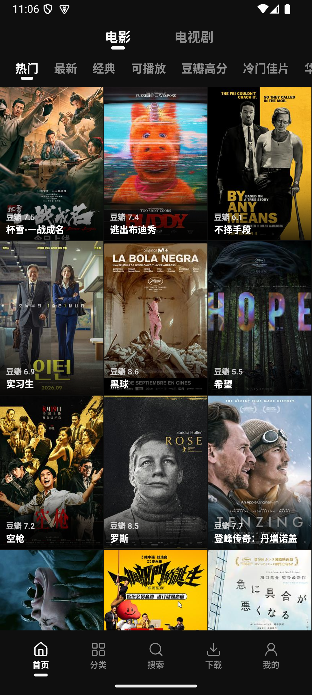</a> | <a href="./docs/images/02-categories.png">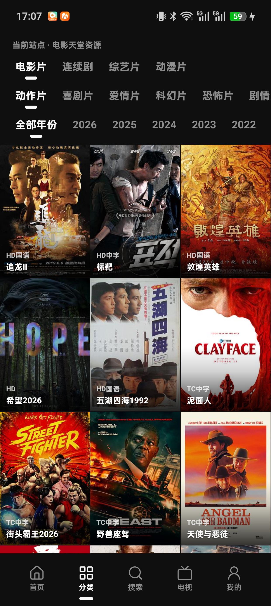</a> | <a href="./docs/images/03-search.png">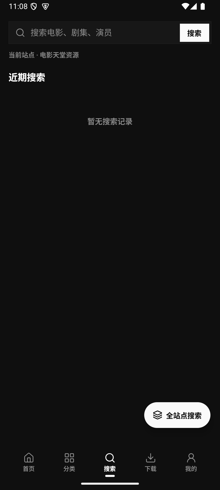</a> |
| **电视 · 我的直播源** | **在线频道库** | **我的** |
| <a href="./docs/images/04-tv.png">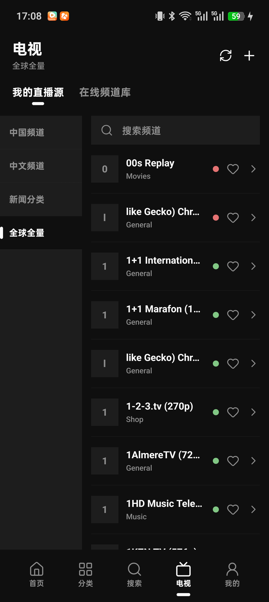</a> | <a href="./docs/images/05-tv-library.png">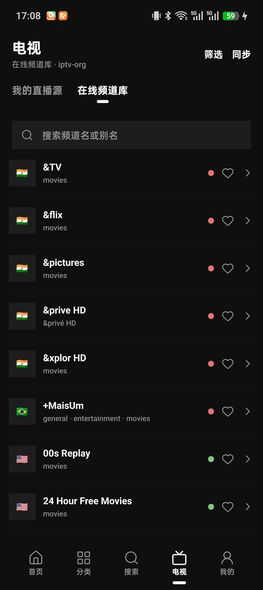</a> | <a href="./docs/images/06-my.png">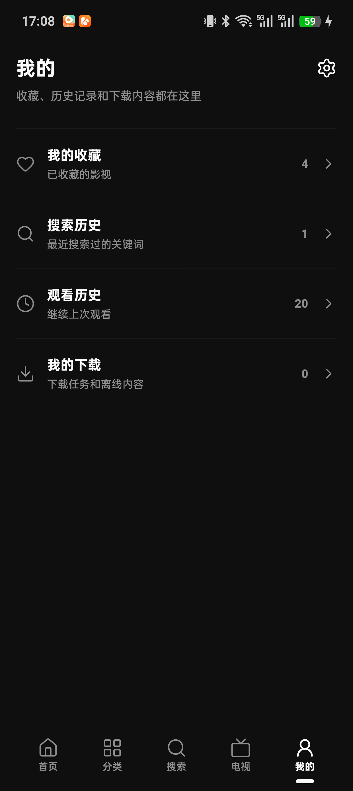</a> |
| **我的收藏** | **观看历史** | **设置** |
| <a href="./docs/images/07-favorites.png">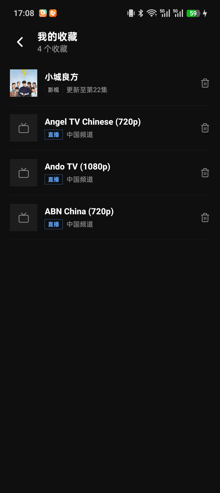</a> | <a href="./docs/images/08-watch-history.png">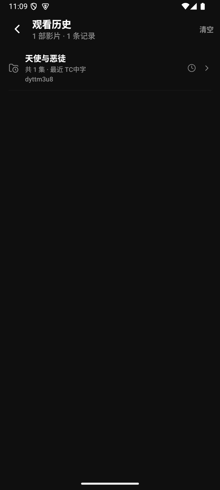</a> | <a href="./docs/images/09-settings.png">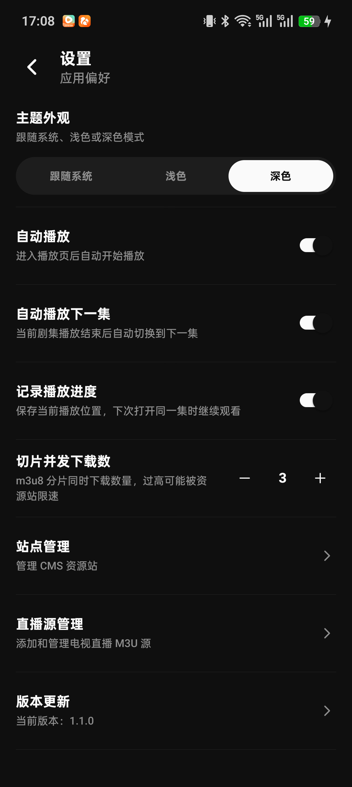</a> |
| **站点管理** | **添加站点** | **直播源管理** |
| <a href="./docs/images/10-sites.png">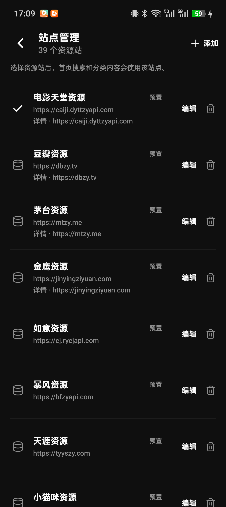</a> | <a href="./docs/images/11-site-edit.png">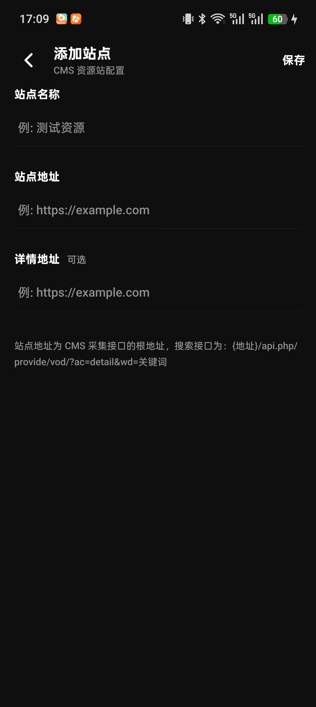</a> | <a href="./docs/images/12-live-sources.png">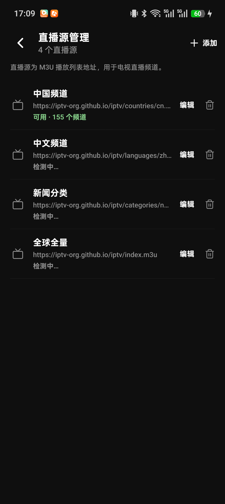</a> |
| **添加直播源** | **影视详情** | **播放器** |
| <a href="./docs/images/13-live-source-edit.png">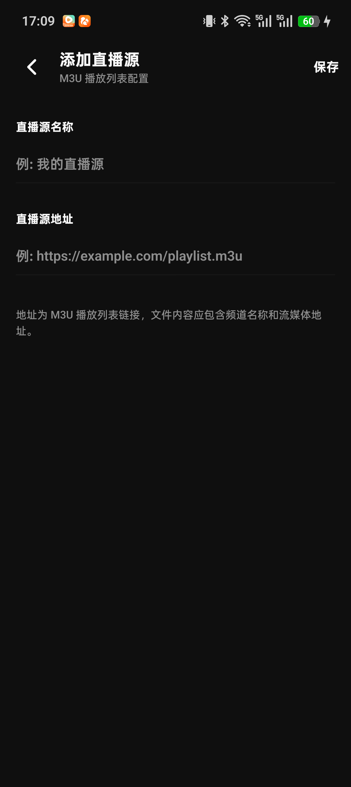</a> | <a href="./docs/images/13-detail.png">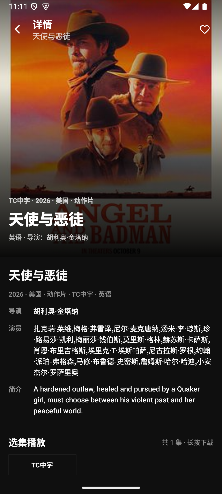</a> | <a href="./docs/images/14-player.png">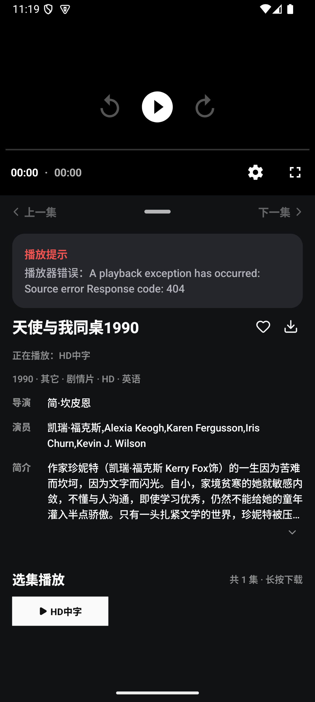</a> |
| **全站点搜索** | **搜索结果** | **搜索历史** |
| <a href="./docs/images/15-aggregate-search.png"></a> | <a href="./docs/images/12-search-results.png">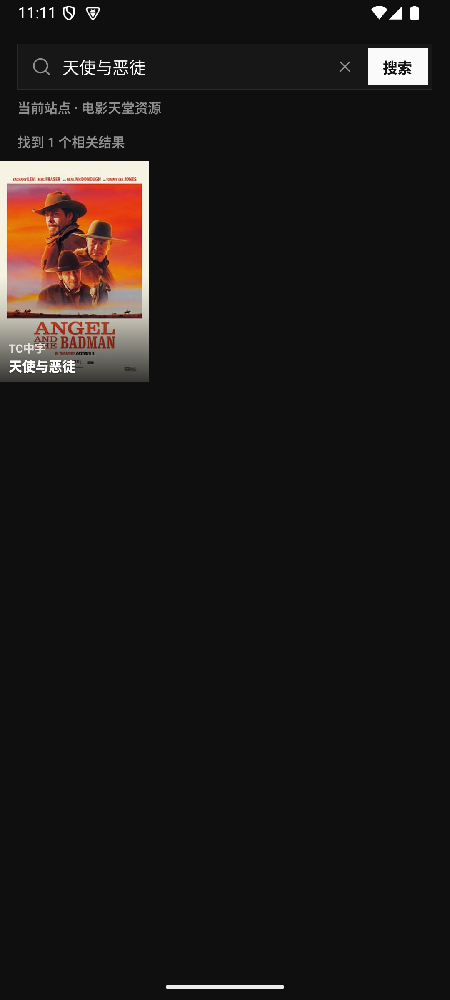</a> | <a href="./docs/images/07-search-history.png">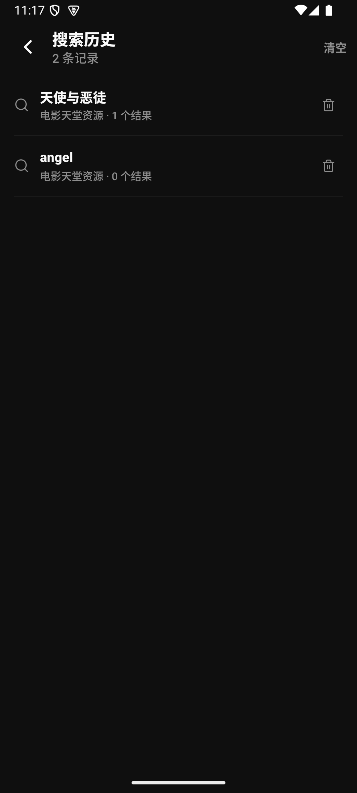</a> |
| **观看历史详情** | **我的下载** | **下载详情** |
| <a href="./docs/images/09-watch-history-folder.png">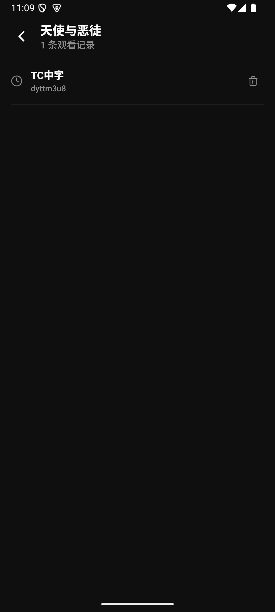</a> | <a href="./docs/images/10-my-downloads.png">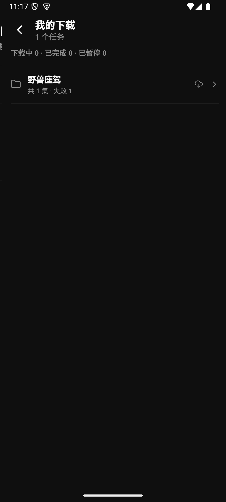</a> | <a href="./docs/images/18-download-folder.png">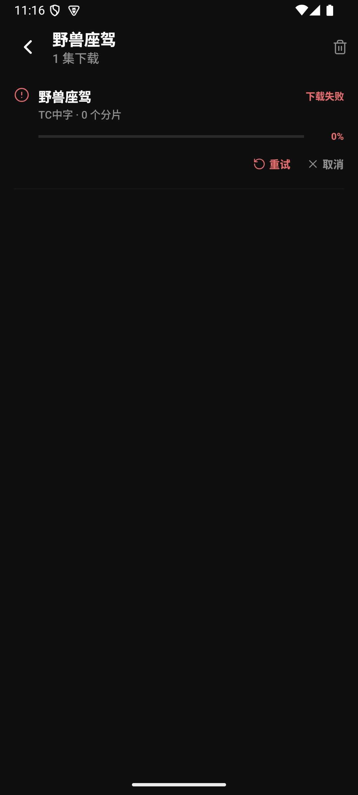</a> |

---

# Movie Night

一个基于 Expo / React Native 实现的移动端影视 + IPTV 应用，支持影视推荐、CMS 资源站搜索、分类浏览、在线播放、收藏、观看历史、离线下载，以及 M3U / iptv-org 在线频道库的电视直播。

> 项目当前基于 Expo SDK 58。涉及 Expo API 时，请优先参考对应版本文档：<https://docs.expo.dev/versions/v58.0.0/>

## 目录

- [功能概览](#功能概览)
- [技术选型](#技术选型)
- [项目结构](#项目结构)
- [核心实现](#核心实现)
- [本地开发](#本地开发)
- [配置说明](#配置说明)
- [构建与部署](#构建与部署)
- [常见问题](#常见问题)
- [开发规范建议](#开发规范建议)

## 功能概览

### 首页推荐

- 使用豆瓣相关接口获取电影 / 电视剧推荐内容。
- 支持标签切换和分页加载。
- 首页卡片采用 3 列海报瀑布式展示。
- 顶部包含 App 开屏 Logo、内容类型切换入口和自定义图片装饰。

### 搜索

- 基于当前选中的 CMS 资源站进行影视搜索。
- 支持搜索历史记录。
- 搜索结果可进入详情页播放或收藏。

### 分类

- 从当前 CMS 资源站拉取分类数据。
- 支持一级 / 二级分类横向切换。
- 分类内容使用 3 列海报卡片展示。
- 顶部显示当前资源站入口，点击站点名称进入站点切换页面。

### 详情与播放

- 支持影视详情、海报、元信息、播放源与剧集列表。
- 当前在线播放仅支持 HLS / m3u8；MP4、FLV 和网页播放地址不会进入在线剧集列表。
- 使用 `expo-video` 作为播放器基础能力。
- 播放页会记录观看历史。

### 收藏与历史

- 支持收藏 / 取消收藏影视。
- 支持收藏 / 取消收藏直播频道（我的直播源与在线频道库都支持）。
- 我的收藏和观看历史都采用影视 / 直播混排，按更新时间倒序排列，并用标签区分类型。
- 影视收藏可进入详情，直播收藏可直接进入横屏直播播放页。
- 观看历史支持影视文件夹分组、直播频道单独删除与整体清空。
- 用户数据存储在本地 SQLite。

### 离线下载

- 支持 HLS / m3u8 离线下载。
- 支持暂停、继续、恢复中状态展示。
- 支持 HLS 分片并发下载，并可在设置中调整并发数量。
- 下载完成后可从下载列表播放或删除。
- 删除下载任务时会同步清理本地文件。

### 站点管理

- 支持添加、编辑、删除 CMS 资源站。
- 支持切换当前使用站点。
- 当前站点会影响搜索、分类、详情和播放数据来源。

### 电视直播

- 底部「电视」Tab 提供「我的直播源」和「在线频道库」两个来源。
- 我的直播源支持手动添加 / 编辑 / 删除 M3U 地址，首次安装会预置中国频道、中文频道、新闻分类、全球全量四个 iptv-org 源。
- 我的直播源使用左侧来源栏 + 右侧频道列表的商城式布局，频道列表支持搜索、收藏与可见窗口自动探测。
- 在线频道库从 iptv-org API 同步到本地 SQLite，支持按国家 / 语言 / 分类筛选，默认显示中国大陆频道。
- 在线频道库支持展示全部 `alt_names`，搜索可同时匹配频道名与别名。
- 直播播放页为全屏横屏，自动隐藏控制，只保留返回、频道名和频道列表入口；支持失败自动重连与手动重试。
- 频道可用性探测只针对当前窗口内的频道，避免一次性请求全部频道。

## 技术选型

| 方向 | 技术 | 说明 |
| --- | --- | --- |
| 应用框架 | Expo SDK 58 | 提供跨平台运行、原生模块集成和构建能力 |
| UI 框架 | React Native 0.88 | 移动端 UI 基础框架 |
| 路由 | expo-router | 基于文件系统的路由管理 |
| 数据库 | expo-sqlite | 本地持久化站点、收藏、历史、下载记录、直播源与频道库缓存 |
| 文件系统 | expo-file-system | 本地下载文件、HLS 分片落盘 |
| 播放器 | expo-video | 在线 / 本地视频播放与横屏直播播放 |
| 屏幕方向 | expo-screen-orientation | 直播播放页横屏锁定与页面方向恢复 |
| 直播数据 | iptv-org API | 频道、流、语言、分类等在线频道库数据 |
| 图片 | expo-image | 海报、Logo、图标等图片展示 |
| 动画 | react-native-reanimated | Tab icon 等交互动效 |
| 玻璃效果 | expo-glass-effect | 底部悬浮玻璃 TabBar，低版本环境自动降级 |
| 图标 | lucide-react-native | 通用线性图标 |
| 样式 | React Native StyleSheet | 统一使用主题色、间距常量 |
| 构建 | Gradle / EAS Build | 支持本地 Android 构建和 EAS 云端构建（Gradle 9.4.1） |

## 项目结构

```text
src/
  app/
    (tabs)/                 # 首页、分类、搜索入口、电视、我的
    mine/                   # 我的收藏、观看历史、下载剧集等二级页面
    sites/                  # 站点管理与编辑
    live-sources/           # 直播源管理与编辑
    _layout.tsx             # 根布局、Provider、数据库初始化
    detail.tsx              # 影视详情页
    player.tsx              # 影视播放页
    live-player.tsx         # 横屏直播播放页
    search.tsx              # 搜索页
  components/
    movie/                  # 影视业务组件：卡片、剧集、下载项等
    iptv/                   # 直播筛选抽屉等组件
    ui/                     # 通用 UI 组件
    themed-text.tsx         # 主题文本
    themed-view.tsx         # 主题容器
    screen-header.tsx       # 二级页头部
  constants/
    api.ts                  # API 常量
    app-settings.ts         # 应用设置常量
    sites.ts                # 默认资源站配置
    iptv.ts                 # 默认直播源配置
    theme.ts                # 主题色、字体、间距
  context/
    download-context.tsx    # 下载任务管理
    site-context.tsx        # 当前站点管理
    iptv-context.tsx        # 直播源管理
    user-data-context.tsx   # 影视/直播收藏、搜索历史、观看历史
  models/                   # TypeScript 数据模型
  services/
    cms-api.ts              # CMS 资源站接口封装
    database.ts             # SQLite 表结构与数据访问
    douban-api.ts           # 首页推荐数据接口
    playback-resolver.ts    # 播放地址解析与 source 构建
    iptv.ts                 # M3U 拉取、解析缓存、可用性探测
    iptv-library.ts         # iptv-org 在线频道库同步与查询
  utils/
    image-url.ts            # 图片 URL 规范化与请求头
    media-groups.ts         # 下载 / 历史分组工具
    iptv.ts                 # M3U 解析与频道分组
```

## 核心实现

### 1. 文件路由

项目使用 `expo-router`，页面直接通过 `src/app` 下的文件组织：

- `src/app/(tabs)/index.tsx`：首页
- `src/app/(tabs)/categories.tsx`：分类
- `src/app/(tabs)/tv.tsx`：电视（我的直播源 / 在线频道库）
- `src/app/(tabs)/my.tsx`：我的
- `src/app/search.tsx`：搜索页
- `src/app/detail.tsx`：详情页
- `src/app/player.tsx`：影视播放页
- `src/app/live-player.tsx`：横屏直播播放页
- `src/app/sites/index.tsx`：站点管理
- `src/app/live-sources/index.tsx`：直播源管理

底部 TabBar 在 `src/app/(tabs)/_layout.tsx` 中配置，当前实现为悬浮玻璃样式，并为选中的 icon 添加持续摆动动画。

### 2. 主题系统

主题集中定义在 `src/constants/theme.ts`：

- `Colors.light`
- `Colors.dark`
- `Spacing`
- `Fonts`

页面通过 `useTheme()` 获取当前主题色，组件尽量使用：

- `colors.background`
- `colors.card`
- `colors.backgroundElement`
- `colors.text`
- `colors.textSecondary`
- `colors.accent`
- `colors.primary`

这样可以保证浅色 / 深色模式表现一致。

### 3. 本地数据库

项目使用 `expo-sqlite` 保存本地数据，主要包括：

- 资源站列表与当前站点
- 影视收藏、直播收藏
- 搜索历史
- 影视观看历史、直播观看历史
- 下载任务记录
- 应用设置
- M3U 直播源及其频道缓存
- iptv-org 在线频道库、流、语言、分类与筛选数据

数据库访问集中在 `src/services/database.ts`，业务层通过 Context 调用，避免页面直接操作 SQL。

### 4. CMS 资源站

CMS 资源站主要用于：

- 关键词搜索
- 分类列表
- 分类内容
- 影视详情
- 播放源与剧集

当前站点由 `SiteProvider` 统一管理，页面通过 `useSite()` 获取：

```ts
const { site, sites, setActiveSite, refreshSites } = useSite();
```

切换站点后，搜索、分类、详情等页面会使用新的资源站地址。

### 5. 直播源与在线频道库

直播相关逻辑主要分布在：

- `src/app/(tabs)/tv.tsx`
- `src/app/live-sources/index.tsx`
- `src/app/live-player.tsx`
- `src/services/iptv.ts`
- `src/services/iptv-library.ts`

我的直播源会拉取 M3U 并解析频道，解析结果按源缓存到 SQLite；再次进入时先展示缓存，再后台刷新。频道列表只对当前可见窗口内的流做可用性探测。

在线频道库通过 jsDelivr CDN 拉取 iptv-org API，失败时自动回退到 `iptv-org.github.io`。频道、流、语言、分类等数据同步到本地 SQLite，支持国家、语言、分类筛选，并以 `alt_names` 参与搜索。

### 6. 播放解析

播放相关逻辑主要分布在：

- `src/app/player.tsx`
- `src/services/playback-resolver.ts`

`playback-resolver` 会处理以下地址类型：

- HLS / m3u8
- 本地文件路径
- content URI

在线剧集列表只保留 m3u8/HLS。普通 MP4、FLV 和网页播放地址不会作为可选集展示；
本地已下载文件仍可由播放器打开。

直播播放页位于 `src/app/live-player.tsx`：

- 我的直播源频道直接把 M3U 中的 URL 交给 `expo-video`。
- 在线频道库频道按 `channelId` 查询本地流，选择最优清晰度并携带 Referer / User-Agent。
- 进入时锁定横屏，退出恢复竖屏；播放出错会自动重连，3 次失败后显示手动重试。

### 7. 离线下载

下载能力集中在 `src/context/download-context.tsx`，对外暴露：

```ts
const {
  downloads,
  startDownload,
  pauseDownload,
  resumeDownload,
  cancelDownload,
} = useDownloads();
```

#### 普通文件下载

m3u8/HLS 分片和播放列表使用 `expo-file-system` 的下载任务能力，支持进度更新、暂停和继续。

#### HLS 下载

HLS 下载会：

1. 拉取根 m3u8。
2. 递归解析子 playlist。
3. 将远端分片、key、子 playlist 映射为本地文件名。
4. 写入改写后的本地 playlist。
5. 并发下载缺失资源。
6. 暂停后保留已完成资源，继续时进入 `recovering` 状态并扫描本地文件。

当前本地 HLS 结构保持简单稳定：

```text
downloads/
  <影片名_剧集名_id>/
    index.m3u8
    part_00001.ts
    part_00002.ts
    part_00003.m3u8
```

### 8. 图片处理

海报图片统一经过 `normalizeImageUrl` 处理，兼容：

- 相对路径
- 绝对路径
- 缺失协议的 URL
- 需要特定请求头的图片源

通用图片展示使用 `AppImage`，内部基于 `expo-image`，并提供加载失败兜底 UI。

## 本地开发

### 环境要求

建议环境：

- Node.js 22.13+（项目已提供 `.nvmrc`，建议 `nvm use`）
- npm 10+
- JDK 17+
- Android Studio
- Android SDK（compileSdk 37 / Gradle 9.4.1）
- Xcode（仅 iOS 开发需要）

检查基础命令：

```bash
node -v
npm -v
java -version
adb version
```

### 安装依赖

```bash
npm install
```

### 启动开发服务

```bash
npm run start
```

或直接：

```bash
npx expo start
```

### 运行 Android

```bash
npm run android
```

等价于：

```bash
expo run:android
```

### 运行 iOS

```bash
npm run ios
```

### 运行 Web

```bash
npm run web
```

### 类型检查

```bash
npx tsc --noEmit
```

### Lint

项目 `package.json` 中保留了：

```bash
npm run lint
```

注意：如果本地尚未安装 Expo lint 相关依赖，首次运行可能会提示安装 ESLint 配置。

## 配置说明

### App 配置

主要配置在 `app.json`：

```json
{
  "expo": {
    "name": "Movie Night",
    "slug": "movie",
    "version": "1.1.0",
    "scheme": "movie",
    "orientation": "default",
    "ios": {
      "bundleIdentifier": "com.vexai.movie"
    },
    "android": {
      "package": "com.vexai.movie",
      "versionCode": 4
    },
    "plugins": [
      ["expo-build-properties", { "android": { "usesCleartextTraffic": true } }]
    ]
  }
}
```

### 环境变量与版本更新接口

App 打开时会请求版本更新接口，接口地址通过 Expo 客户端环境变量配置：

```env
EXPO_PUBLIC_APP_VERSION_API_URL=你的版本接口地址
```

变量名必须以 `EXPO_PUBLIC_` 开头，否则客户端 JS 代码无法读取。

本地真机测试可以在项目根目录创建 `.env.local`：

```env
EXPO_PUBLIC_APP_VERSION_API_URL=http://192.168.1.7:8080/api/app/version
```

Android 模拟器访问宿主机本地服务时可以使用：

```env
EXPO_PUBLIC_APP_VERSION_API_URL=http://10.0.2.2:8080/api/app/version
```

打包正式 release 包时，推荐使用 `.env.production`：

```env
EXPO_PUBLIC_APP_VERSION_API_URL=https://你的正式域名/api/app/version
```

注意：Expo 的 `EXPO_PUBLIC_` 环境变量会在构建时内联到客户端代码中。修改 env 文件后，需要重新启动 Expo 服务；打包 release 包前，应确认当前环境变量已经是目标环境的接口地址。

### 网络与 HTTP

由于部分 CMS 资源站 / 直播流可能仍使用 HTTP，Android 通过 `expo-build-properties` 开启：

```json
{
  "expo-build-properties",
  {
    "android": {
      "usesCleartextTraffic": true
    }
  }
}
```

屏幕方向使用 `orientation: "default"`，应用启动时默认锁定竖屏，直播播放页进入时锁定横屏、退出后恢复。

iOS 配置中开启了 ATS 放行：

```json
"NSAppTransportSecurity": {
  "NSAllowsArbitraryLoads": true
}
```

如果后续上架正式商店，建议根据实际域名收紧网络安全策略。

### 启动图与图标

图标与启动图配置：

- App icon：`assets/images/icon.png`
- Android adaptive icon：`assets/images/android-icon-foreground.png`、`assets/images/android-icon-monochrome.png`
- Splash image：`assets/images/splash-icon.png`
- Web favicon：`assets/images/favicon.png`

Android adaptive icon 由 `assets/images/icon.png` 居中裁剪并缩放生成，输出尺寸会沿用现有 Android 图标文件的尺寸。替换 `assets/images/icon.png` 后执行：

```bash
node scripts/generate-android-icons.mjs
npx expo prebuild --platform android --clean
```

脚本会覆盖原有 `assets/images/android-icon-foreground.png` 和 `assets/images/android-icon-monochrome.png`，`app.json` 继续使用这两个原文件名。

### EAS 配置

EAS 构建配置在 `eas.json`：

- `development`：开发构建
- `preview`：内部测试构建
- `production-apk`：生产 APK，适合直接安装分发
- `production`：生产构建，通常用于商店分发

## 构建与部署

项目支持三种 Android 生产包构建方式：

1. 本地 Gradle 构建。
2. Expo 本地 Release 构建。
3. EAS 云端构建。

### 构建目录速查

| 类型 | 构建命令 | 输出目录 / 文件 |
| --- | --- | --- |
| Debug APK | `cd android && ./gradlew assembleDebug` | `android/app/build/outputs/apk/debug/app-debug.apk` |
| Release APK | `cd android && ./gradlew assembleRelease` | `android/app/build/outputs/apk/release/app-release.apk` |
| Release AAB | `cd android && ./gradlew bundleRelease` | `android/app/build/outputs/bundle/release/app-release.aab` |
| Go server 托管 APK | `cd /Users/flower/react-native/movie-server && ./scripts/copy-apk.sh` | `/Users/flower/react-native/movie-server/apks/app-release.apk` |

使用 `.env.production` 构建生产包时，可以执行：

```bash
npm run prebuild:android:prod
npm run assemble:android:release:prod
```

构建前请确认使用 Node 22+（项目 `.nvmrc` 已固定）。`assemble:android:release:prod` 生成的 APK 位于：

```text
android/app/build/outputs/apk/release/app-release.apk
```

安装到手机：

```bash
adb install -r android/app/build/outputs/apk/release/app-release.apk
```

### 方式一：本地 Android 构建

#### 生成原生工程

如果项目没有 `android/` 目录，先执行：

```bash
npx expo prebuild --platform android
```

如果已经存在 `android/` 目录，可以跳过。

#### Debug APK

```bash
cd android
./gradlew assembleDebug
```

输出文件：

```text
android/app/build/outputs/apk/debug/app-debug.apk
```

安装到手机：

```bash
adb install -r android/app/build/outputs/apk/debug/app-debug.apk
```

如果当前已经在 `android/` 目录下：

```bash
adb install -r app/build/outputs/apk/debug/app-debug.apk
```

#### Release APK

```bash
cd android
./gradlew clean
./gradlew assembleRelease -PreactNativeArchitectures=arm64-v8a
```

输出文件：

```text
android/app/build/outputs/apk/release/app-release.apk
```

安装到手机：

```bash
adb install -r android/app/build/outputs/apk/release/app-release.apk
```

#### Release AAB

如果需要上传 Google Play，通常构建 AAB：

```bash
cd android
./gradlew bundleRelease
```

输出文件：

```text
android/app/build/outputs/bundle/release/app-release.aab
```

### 方式二：Expo 本地 Release 构建

在项目根目录执行：

```bash
npx expo run:android --variant release
```

这个命令底层仍会调用 Android Gradle 构建。

### 方式三：EAS 云端构建

#### 安装并登录 EAS CLI

```bash
npm i -g eas-cli
eas login
```

首次使用可执行：

```bash
eas build:configure
```

#### 云端构建 APK

项目已配置 `production-apk` profile：

```bash
eas build -p android --profile production-apk
```

构建完成后，终端会输出下载链接。

#### 云端构建 AAB

```bash
eas build -p android --profile production
```

`production` profile 开启 `autoIncrement`，适合正式分发。

### APK 与 AAB 区别

| 命令 / Profile | 输出 | 用途 |
| --- | --- | --- |
| `./gradlew assembleDebug` | Debug APK | 本地调试安装 |
| `./gradlew assembleRelease` | Release APK | 直接安装、内测分发 |
| `./gradlew bundleRelease` | AAB | Google Play 上传 |
| `eas build -p android --profile production-apk` | APK | 云端构建、直接安装 |
| `eas build -p android --profile production` | AAB | 云端构建、商店分发 |

## 常见问题

### 1. Android 本地 HLS 播放失败

如果下载完成的 HLS 视频无法播放，优先检查：

- `destPath` 是否指向本地 `index.m3u8`。
- `index.m3u8` 内部是否全部引用本地相对路径。
- 分片文件是否真实存在。
- Android 日志中是否有 `ENOENT` 或 `FileNotFoundException`。

HLS 本地播放对路径解析比较敏感，当前项目倾向使用简单的同目录结构，减少 Android FileProvider / ExoPlayer 相对路径解析问题。

### 2. 下载任务重启后变成暂停

这是预期行为。应用重启时，之前处于：

- `active`
- `recovering`

的任务会恢复为 `paused`，由用户手动点击继续。这样可以避免 App 重启后自动启动大量后台下载。

### 3. Release 签名错误

如果本地构建 release 时提示：

```text
SigningConfig "release" is missing required property
```

需要配置 Android release 签名。示例：

```bash
keytool -genkeypair \
  -alias movie \
  -keyalg RSA \
  -keysize 2048 \
  -validity 10000 \
  -keystore android/app/release.keystore
```

在项目根目录创建 `android/keystore.properties`：

```properties
storeFile=release.keystore
storePassword=你的_store_password
keyAlias=movie
keyPassword=你的_key_password
```

`storeFile` 相对于 `android/app` 解析；`android/keystore.properties` 和 `.keystore` 文件默认已在 `.gitignore` 中，不会提交到仓库。

### 4. Gradle 下载超时

如果执行 Gradle 构建时下载依赖超时，可以检查：

```text
android/gradle/wrapper/gradle-wrapper.properties
```

必要时替换为可访问的 Gradle 镜像，或使用 EAS 云端构建。

### 5. EAS 出现 Node punycode 警告

如果看到：

```text
[DEP0040] DeprecationWarning: The `punycode` module is deprecated
```

这是 Node 兼容性警告，通常不影响 EAS 构建。

### 6. 资源站图片不显示

可检查：

- 图片 URL 是否为相对路径。
- CMS 资源站是否需要 Referer / User-Agent。
- `normalizeImageUrl` 是否能正确拼接 baseUrl。
- 当前资源站是否允许外链图片。

### 7. 在线频道库同步失败

在线频道库默认从 jsDelivr CDN 拉取 iptv-org API，失败会自动回退到 `iptv-org.github.io`。如果两边都超时或返回非 JSON，优先检查手机网络、代理或运营商拦截；「服务器返回的数据格式无效」通常表示拿到了 HTML 错误页而不是 JSON。

### 8. 直播播放一段时间后停止

常见原因是直播流本身的分片返回 404 或连接被重置。播放器会自动重连当前频道，最多 3 次；仍失败会显示「播放失败，请重试」。如果频繁发生，建议在频道列表中换一个可用线路，或重新同步 / 刷新直播源。

## 开发规范建议

### 页面与组件

- 页面放在 `src/app`。
- 业务组件放在 `src/components/movie`。
- 通用组件放在 `src/components` 或 `src/components/ui`。
- 页面尽量只负责状态组合和路由跳转，复杂业务逻辑放到 `context` 或 `services`。

### 样式

- 优先使用 `Spacing` 控制间距。
- 优先使用 `useTheme()` 获取颜色。
- 避免在多个文件中散落重复颜色值。
- 海报类卡片统一使用 `PosterOverlayCard`。
- 3 列卡片建议启用 `compact` 模式，避免文字过大。

### 数据访问

- SQLite 操作集中放在 `src/services/database.ts`。
- 页面不直接写 SQL。
- 用户数据通过 `UserDataProvider` 获取。
- 站点数据通过 `SiteProvider` 获取。
- 下载任务通过 `DownloadProvider` 获取。

### 下载与播放

- 下载状态必须同步更新内存状态和 SQLite 状态。
- 取消 / 删除下载任务时，应同时清理数据库记录和本地文件。
- HLS playlist 改写时，尽量保持本地相对路径简单稳定。
- Android 本地播放问题优先看实际设备日志。

### 提交前检查

建议每次提交前执行：

```bash
npx tsc --noEmit
```

如果 lint 依赖已配置完整，也可以执行：

```bash
npm run lint
```

## 免责声明

本项目仅用于学习 Expo / React Native、移动端播放、CMS 数据接入和离线下载等技术实现。请确保接入的资源站、播放内容和下载行为符合当地法律法规及内容版权要求。

### 最新APP版本信息接口返回结构

```json
{
  "latestVersion":"1.0.1",
  "forceUpdate":false,
  "updateUrl":"http://192.168.1.7:8080/downloads/app-release.apk",
  "releaseNotes":"小版本优化\r\n支持广告关闭"
}
```
